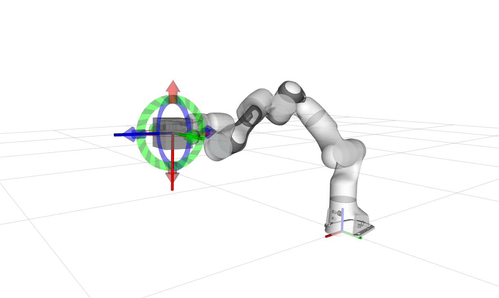

# Arms ROS2 Control

本仓库包含用于机械臂和机器人手臂的ros2-control文件。它为ROS2环境中的各种机器人机械臂提供控制器和硬件接口。

## 目录

- [项目结构](#项目结构)
- [依赖项](#依赖项)
- [测试环境](#测试环境)
- [快速开始](#快速开始)
- [组件](#组件)
- [配置](#配置)
- [腰部电流环与两层重力补偿](#腰部电流环与两层重力补偿)
- [开发](#开发)
- [故障排除](#故障排除)
- [许可证](#许可证)

## 项目结构

项目组织如下：

```
arms_ros2_control/
├── controller/                    # 控制器实现
│   ├── ocs2_arm_controller/      # 基于OCS2的机械臂控制器
│   └── adaptive_gripper_controller/ # 自适应夹爪控制器
├── hardwares/                    # 硬件接口实现
│   ├── topic_based_ros2_control/ # 基于话题的硬件接口
│   └── unitree_ros2_control/    # Unitree机器人硬件接口
├── command/                      # 命令输入实现
│   ├── arms_ros2_control_msgs/  # 控制输入消息定义
│   ├── arms_rviz_control_plugin/ # RViz控制插件
│   ├── arms_target_manager/     # 目标管理系统
│   └── arms_teleop/             # 统一遥操作包
│       └── joystick_teleop      # 基于手柄的控制
└── README.md
```

## 依赖项

本包依赖于：

- [`robot_descriptions`](https://github.com/fiveages-sim/robot_descriptions) - 机器人描述文件（URDF、XACRO）
- [`ocs2_ros2`](https://github.com/legubiao/ocs2_ros2) - OCS2 ROS2集成（`ocs2_arm_controller`需要）

**包放置位置**：`robot_descriptions`和`ocs2_ros2`都应该放在ROS2工作空间的`src`目录中，与`arms_ros2_control`并列：

```
ros2_ws/
├── src/
│   ├── robot_descriptions/        # 机器人描述文件
│   ├── ocs2_ros2/                # OCS2 ROS2集成
│   └── arms_ros2_control/        # 本包
├── install/
└── log/
```

## 测试环境

本包已在以下ROS2发行版中测试并验证可用：

- **ROS2 Jazzy** (Ubuntu 24.04)


## 快速开始

<details>
<summary><strong>📥 Git克隆项目及依赖项（点击展开）</strong></summary>

要获取此项目及其依赖项，请在ROS2工作空间中克隆以下仓库：

```bash
# 导航到ROS2工作空间
cd ~/ros2_ws/src

git clone https://github.com/fiveages-sim/arms_ros2_control
git clone https://github.com/fiveages-sim/robot_descriptions
git clone https://github.com/legubiao/ocs2_ros2

# 初始化robot_descriptions中必需的子模块
cd robot_descriptions
git submodule update --init common manipulator/Dobot

# 使用rosdep安装依赖项
cd ~/ros2_ws
rosdep install --from-paths src --ignore-src -r -y
```

**注意**：
- `rosdep install` 命令将自动安装所有必需的系统依赖项

</details>

<details>
<summary><strong>🔧 验证OCS2设置（可选）</strong></summary>

如果您是第一次接触OCS2，请先验证OCS2环境是否正确配置。通过运行移动机械臂演示之一来验证：

```bash
# 初始化ocs2 robotic assets子模块
cd ~/ros2_ws/src/ocs2_ros2
git submodule update --init submodules/ocs2_robotic_assets

# 构建移动机械臂包
cd ~/ros2_ws
colcon build --packages-up-to ocs2_mobile_manipulator_ros --symlink-install

# 尝试可用的演示之一：
source ~/ros2_ws/install/setup.bash

# Franka Panda
ros2 launch ocs2_mobile_manipulator_ros franka.launch.py

# 或 Mabi-Mobile
ros2 launch ocs2_mobile_manipulator_ros manipulator_mabi_mobile.launch.py
```

如果这些演示中的任何一个成功运行，则您的OCS2环境配置正确。有关更多可用演示，请参阅[ocs2_mobile_manipulator_ros README](https://github.com/legubiao/ocs2_ros2/tree/ros2/basic%20examples/ocs2_mobile_manipulator_ros)。



</details>

### 1. 构建包

```bash
cd ~/ros2_ws
colcon build --packages-up-to ocs2_arm_controller cr5_description arms_teleop adaptive_gripper_controller --symlink-install
```

### 2. 使用模拟硬件启动

* OCS2机械臂控制器
  ```bash
  source ~/ros2_ws/install/setup.bash
  ros2 launch ocs2_arm_controller demo.launch.py type:=AG2F90-C
  ```

> **交互式控制：**
> - 按按钮在OCS2控制器FSM之间切换并切换夹爪。
> - 在RViz中，拖拽交互式标记设置目标位置，然后右键单击发送轨迹命令
>
> 

### 3. 使用Gazebo仿真启动

* 安装Gazebo Harmonic
    ```bash
    sudo apt-get install ros-jazzy-ros-gz ros-jazzy-gz-ros2-control
    ```

#### 启动控制器：
这里使用了Agibot G1作为其他机器人的示例。
* 编译机器人描述
  ```bash
  cd ~/ros2_ws
  colcon build --packages-up-to agibot_g1_description --symlink-install
  ```
* 你可以使用`world`来选择gazebo世界
  ```bash
  source ~/ros2_ws/install/setup.bash
  ros2 launch ocs2_arm_controller demo.launch.py robot:=agibot_g1 hardware:=gz world:=warehouse
  ```
  

### 4. 使用Isaac Sim仿真启动

* 编译增强的topic_based_ros2_control包
  ```bash
  cd ~/ros2_ws
  colcon build --packages-up-to topic_based_ros2_control --symlink-install
  ```
* 启动控制器（在此步骤之前启动Isaac Sim）
  ```bash
  source ~/ros2_ws/install/setup.bash
  ros2 launch ocs2_arm_controller demo.launch.py hardware:=isaac type:=AG2F90-C
  ```
  

## 组件

### 控制器

#### OCS2机械臂控制器

`ocs2_arm_controller`使用OCS2框架为机械臂提供基于MPC的控制。

**特性：**

- 用于轨迹跟踪的模型预测控制（MPC）
- 实时优化
- 支持各种机器人配置

#### 自适应夹爪控制器

`adaptive_gripper_controller`提供基础夹爪控制功能，具有位置读取和输出能力。

**特性：**

- 从硬件接口读取位置信息
- 向硬件接口输出位置命令
- 基础夹爪位置控制
- 易于理解和扩展

### 硬件接口

#### 基于话题的硬件接口

`topic_based_ros2_control`包提供通过ROS2话题通信的通用硬件接口。原始版本可在[topic based ros2 control](https://github.com/PickNikRobotics/topic_based_ros2_control)找到。

**特性：**

- 适用于任何硬件的通用接口
- 基于话题的通信
- 易于与自定义硬件集成

#### Unitree硬件接口

`unitree_ros2_control`包基于unitree_sdk2为Unitree机器人提供硬件接口。

**特性：**

- 支持Unitree G1和其他sdk2兼容机器人
- Mujoco仿真集成
- 真实机器人支持

### 命令输入系统

#### Arms RViz控制插件

`arms_rviz_control_plugin`提供智能RViz插件，结合了OCS2机械臂控制器和自适应夹爪控制器的控制功能。

**特性：**

- **OCS2机械臂控制器控制：**
  - 智能FSM状态显示和切换
  - 动态按钮控制，只显示可用的状态转换
  - 遵循OCS2机械臂控制器FSM规则的正确状态转换
  - HOLD初始状态和正确的状态流程
  - HOME状态下的姿态切换功能
- **夹爪控制器控制：**
  - 左右夹爪控制按钮
  - 实时夹爪状态显示
  - 单臂/双臂夹爪支持
  - 自动控制器检测和UI适配

#### Arms目标管理器

`arms_target_manager`为设置机械臂末端执行器目标姿态提供3D交互式标记。

**特性：**

- RViz中的3D交互式标记
- 单臂/双臂支持
- VR遥操作
- 手柄遥操作

#### Arms遥操作

`arms_teleop`包为机械臂提供统一的遥操作功能。

**特性：**

- 基于手柄的控制
- 基于键盘的控制
- 不同输入方法的统一接口

## 配置

### 机器人配置

机器人特定配置存储在`robot_descriptions`包中。每个机器人都有自己的描述包，包含：

- URDF/XACRO文件
- 配置文件
- 网格文件

### 控制器配置

控制器配置存储在相应的控制器包中：

- `ocs2_arm_controller/config/` - OCS2控制器配置
- 硬件特定配置在硬件接口包中

## Juxie 控制模式：位置环、速度环与电流环

W2 的 Juxie 腰部/头部支持逐关节选择控制模式。配置位于机器 profile 的
`hardware.juxie_joint_modes`；未列出的关节默认为 `csp`。

| 模式 | 命令接口 | 驱动行为 |
| --- | --- | --- |
| `csp` | `position` | 位置命令直接发送到电机位置环 |
| `csv` | `velocity` | 速度命令直接发送到电机速度环 |
| `cst` | `position` + `velocity` | 两者作为位置/速度参考，驱动内部阻抗环计算电流并发送到电机电流环 |

`csv` 和 `cst` 所需的硬件接口及控制器命令接口由 profile 自动派生；全身和分体控制器无需重复配置关节名单。
电流环不导出 `effort` 命令接口。

示例：

```yaml
hardware:
  juxie_joint_modes:
    body_joint1: cst
    body_joint2: cst
    head_joint1: csv
```

电流环由驱动以 2 ms 周期按 `I = Kp(q_d-q) + Kd(q̇_d-q̇) + 重力前馈 + 摩擦前馈` 计算，
输出受 `max_current_ma` 限制。参数默认来自描述包的 `juxie_joint_impedance.yaml`；机器 profile 只需覆盖差异项。

腰部重力前馈有两种来源：控制器发布的新鲜 RNEA 结果优先；话题超时后，驱动使用
`gravity_ff_table` 指定的查表值。两种来源不叠加。表路径错误会导致硬件初始化失败。
使用 `python3 scripts/identify_juxie_friction_gravity.py table` 生成查表文件。

反馈异常超过 `feedback_timeout_cycles` 后，驱动将对应电机锁存为 CSP 位置保持并忽略后续命令。

阻抗测试工具 `scripts/juxie_impedance.py` 支持离线自检、仿真和单电机 HIL。HIL 会接管所选电机；
测试前停止 `ros2_control`，固定其余关节和负载，并设置保守的电流、转速和行程限制。

### 快速摆臂时的腰部惯性前馈（WBC，可选）

静态重力补偿 `g(q)` 不包含摆臂加速、减速产生的反作用力矩。WBC 可在相同负载快照中计算
`Δτ = RNEA(q, v_arm, a_arm) - RNEA(q, 0, 0)`，将腰部对应的附加电流发到
`<gravity_ff_topic>/dynamic`，由驱动与重力前馈相加，重力话题本身仍只包含静态项。
`v_arm` 取硬件速度状态接口，`a_arm` 由实测速度差分后限幅、低通得到；不使用 MPC 目标速度。
只启用模型中 `left_joint*`、`right_joint*` 的速度与加速度，腰部、头部和底盘运动分量设为零。
因此这是双臂运动的附加补偿，不是全身完整逆动力学。

参数放在 `robot.local.yaml` 的 `control.patch.ocs2_wbc_controller.ros__parameters` 下：

```yaml
waist_dynamic_ff_gain: 0.0                # 默认关闭；范围 [0, 1]
waist_dynamic_ff_max_ma: 0.0              # 每个腰关节的附加电流限幅；启用前须确定正值
waist_dynamic_ff_filter_hz: 10.0           # 速度/加速度估计低通，Hz
waist_dynamic_ff_max_acceleration: 20.0    # 加速度估计限幅，rad/s²
waist_dynamic_ff_advance_ms: 0.0           # 前馈超前量 [0,50] ms，补偿滤波/发布滞后
waist_dynamic_ff_accel_method: diff_lpf    # 加速度估计：diff_lpf（差分+一阶低通）| sg（Savitzky-Golay）
waist_dynamic_ff_sg_window: 9              # sg 的窗口长度（奇数 [5,31]，9 ≈ 18 ms @500 Hz）
```

`waist_dynamic_ff_advance_ms` 用一阶泰勒把手臂速度/加速度外推到“真正作用时刻”
（`v ← v + T·a`，`a ← a + T·ȧ`），再进 RNEA；`0` 即不超前，行为与未加该参数时一致。

为什么是超前而不是延后：手臂指令的 `future_time_offset`（22 周期 = 44 ms）是用来抵消
位置环延迟的 —— 前视准了以后，手臂实际轨迹与 policy 在时间上已经对齐，实测 `q / q̇`
就是当下正在发生的运动。真正错位的是**前馈链路自身**：10 Hz 一阶低通约 16 ms、
100 Hz 发布平均 5 ms、CAN 发帧 1–2 ms，合计让 FF 晚 20–25 ms。因此按 15–25 ms 标定
advance 才对齐；用环形缓冲去“延后”会把误差翻倍。

标定方法：摆臂正弦（0.5/1/2/3 Hz）同时记录腰部关节跟踪误差与 `/body_gravity_feedforward_ma/dynamic`，
扫 `advance_ms`（0–40）取腰角误差 RMS 最小点。纯低通在 0.5–3 Hz 的滞后实测约 15 ms，
加上发布周期后从 20–25 ms 起扫即可。

加速度估计有两种可配方法（`waist_dynamic_ff_accel_method`）：

| 方法 | 做法 | 滞后 | 特点 |
|---|---|---|---|
| `diff_lpf`（默认） | 速度一阶差分 → 限幅 → 一阶低通 | ≈ 15 ms（10 Hz） | 最简单；低通把高频噪声压住的同时带来相位滞后 |
| `sg` | 对速度做窗口内二次最小二乘拟合，取一次项作加速度、二次项作加速度导数 | ≈ 窗口/2 个采样（9 点 ≈ 8 ms） | 滞后减半，`advance` 的外推项不再需要对加速度二次差分 |

两种方法都只在本拍位于 `waist_gravity_ff_decimation` 发布周期时进 RNEA；窗口未填满（`sg` 需
`window` 个采样）期间只发静态重力。两者噪声增益接近（速度噪声都被 ×1/dt 放大），
`sg` 的优势是相位更靠前、不衰减幅度；若噪声明显，可加长 `sg_window` 或调低 `filter_hz`。

附加电流先按 `max_ma` 限幅，再与重力电流相加，最终仍受驱动总电流限幅和变化率限制。
驱动仅在静态重力话题有效且动态数据接收后不超过 20 ms 时使用动态项，并沿用重力接管的渐变权重；
动态项超时即将该目标分量归零，不会保留 0.5 秒。实际电流的回落仍受总电流变化率限制。
动态发布采用 best_effort、depth 1、20 ms lifespan；需同时更新支持该话题的 Juxie 驱动。
滤波每个 update 周期更新，RNEA 和发布沿用 `waist_gravity_ff_decimation`，默认约 100 Hz。
启用动态项时应保持至少约 100 Hz 的发布频率，避免触及 20 ms 超时。
控制器重新激活、速度无效或控制周期间隔超过 50 ms 时清空动态估计，首个有效样本只初始化速度。
无效速度时继续发布静态重力补偿；无效位置时不发布。动态参数须卸载并重新加载控制器才能修改。
分体模式仍只发布静态重力补偿，启用动态增益会被拒绝。

目前默认关闭，未在真机验证。启用前应核对 URDF 惯量、末端负载及 mA/N·m 换算，并在有支撑的条件下
从小增益、小附加电流限幅、低速开始验证。即使对齐到最佳 advance，实测速度噪声与模型误差仍存在，
不能保证消除晃动；腰部阻抗、结构间隙以及驱动延迟也需要结合记录分析。

## 开发

### 添加新机器人

1. 将机器人描述添加到`robot_descriptions/manipulator/`
2. 在相应的控制器包中创建配置文件
3. 更新启动文件以包含新机器人
4. 在转移到真实机器人之前，使用模拟和仿真器硬件进行测试

### 添加新控制器

1. 在`controller/`目录中创建新包
2. 实现控制器接口
3. 添加配置和启动文件
4. 使用使用说明更新此README

## 故障排除

### 常见问题

1. **构建错误**：确保所有依赖项都已安装和构建
2. **启动错误**：检查机器人描述是否正确安装
3. **硬件连接**：验证硬件接口配置

### 获取帮助

- 查看各个包的README文件以获取具体说明
- 查看`ocs2_ros2`文档以了解OCS2特定问题
- 查看`robot_descriptions`包以了解机器人特定配置

## 许可证

本包根据Apache License 2.0许可。详情请参阅[LICENSE](LICENSE)文件。 
