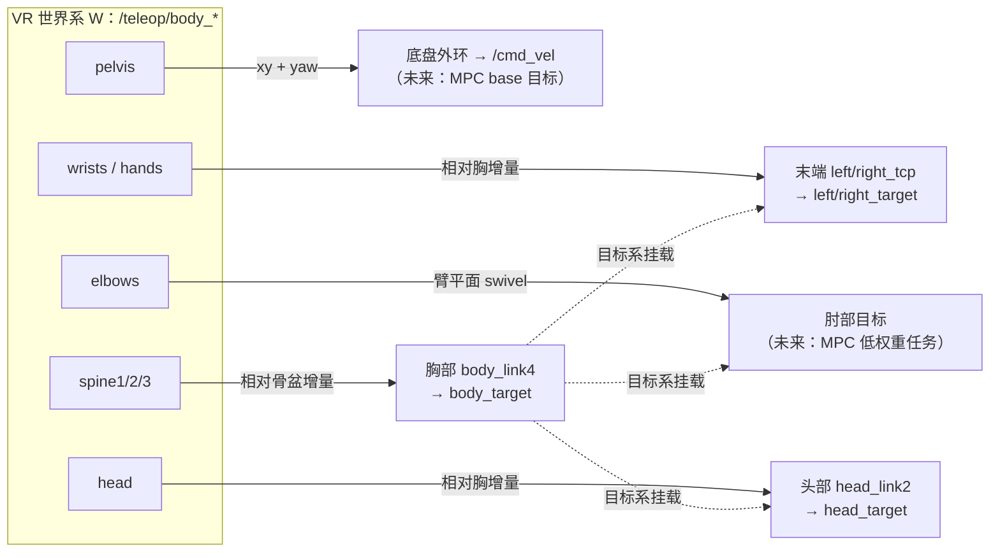

# 基于 VR 全身骨骼的轮式人形全身遥操作映射算法（设计稿）

> 状态：**v1 已实现**——§3.3 胸部（骨盆→spine3 相对旋转增量，1:1 位置）与 §3.4 头部
> （骨架数据源）已接入 `VRInputHandler` case 30 组合键；肘部（§3.2）、底盘（§3.5）、
> α 缩放/分轴限幅等仍为设计稿。
> 输入：XRoboToolkit 后端全身追踪（24 关节 SMPL 风格骨架，机器人轴约定）。
> 目标机器人示例：FiveAges W2（轮式人形；4 腰关节 + 7×2 臂 + 2 头关节；`body_link4` 胸部、`head_link2` 头部、`left/right_tcp` 末端）。

## 0. 目标与现状

| 跟踪对象 | 机器人参考 frame | 现状 | 本文档 |
|---|---|---|---|
| 双臂末端 | `left_tcp` / `right_tcp` | ✅ `left/right_target`（手柄 / VR 增量） | §3.1 增量为"相对胸系" |
| 双臂肘部 | `{side}_link4`（joint4 轴心） | ❌ 未实现，未接 MPC | §3.2 新增（算法 + MPC 接入草案） |
| 胸部 | `body_link4` | 🟡 有 `body_target` 通道，由摇杆驱动 | §3.3 改为骨架驱动 |
| 头部 | `head_link2` | ✅ `head_target`（头显 1:1 增量） | §3.4 增量为"相对胸系" |
| 底盘 | `base_footprint` (x, y, yaw) | ❌ 未接 MPC 目标 | §3.5 外环 + MPC 接入草案 |

VR 侧数据（`xr_target_node`，XRoboToolkit 后端）：

- `/teleop/body_<关节名>_pose`（`geometry_msgs/Pose`，24 关节，头显开启 Whole Body Motion Tracking 且配对足部追踪器后动态出现，断流 5 s 销毁话题）；
- 与 `/teleop/head_pose`、手柄 pose **同一世界系、同一原点**（App 启动时头显位置），OpenXR→机器人轴转换已在上游 wrapper 完成。

## 1. 坐标系与数据语义

### 1.1 人体骨架拓扑（父→子）

```
pelvis(0) ─┬─ left_hip(1)  → left_knee(4)  → left_ankle(7)  → left_foot(10)
           ├─ right_hip(2) → right_knee(5) → right_ankle(8) → right_foot(11)
           └─ spine1(3) → spine2(6) → spine3(9) ─┬─ neck(12) → head(15)
                                                 ├─ left_collar(13)  → left_shoulder(16)  → left_elbow(18)  → left_wrist(20)  → left_hand(22)
                                                 └─ right_collar(14) → right_shoulder(17) → right_elbow(19) → right_wrist(21) → right_hand(23)
```

### 1.2 机器人被控 frame（W2 实测值）

| 对象 | frame | 说明 |
|---|---|---|
| 控制系 C | `base_footprint` | 目标统一在 C 中表达（现有 `control_base_frame`） |
| 胸部 | `body_link4` | 原点在腰顶上方 **0.1433 m**（躯干下沿）；`arm_base` 在其上 0.4576 m、`head_mount` 0.4848 m |
| 腰部 | `body_joint1/2/3` 绕 ±y（pitch）、`body_joint4` 绕 −z（yaw） | **无 roll 自由度** |
| 头部 | `head_link2` | `head_joint1` yaw(z)、`head_joint2` pitch(y)，关节间距 0.15 m |
| 末端 | `left_tcp` / `right_tcp` | 7-DOF 臂，肘在 `{side}_joint4`（link4 原点） |
| 底部 | `base_footprint` (x,y,yaw) | 轮式底盘，world→base TF 由外部提供 |

手臂标称几何（URDF 常量，落地时建议运行期从 FK 实测）：

- 上臂 $l_1 \approx 0.305$ m（joint2/3 轴心 → joint4 轴心）；
- 前臂 $l_2 \approx 0.314$ m（joint4 轴心 → joint5 轴心，再加 tcp 偏置到 tip）。

### 1.3 控制系与校准

- 记 VR 世界系为 W，控制系为 C。接管时刻 $t_0$ 冻结 $R_{C\leftarrow W}(t_0)$——**沿用现有 `vr_follow_frame` + 冻结 `R_C_F` 机制**，本文档仅用统一记号表述。
- 若胸部开始跟踪（§3.3），建议将冻结旋转升级为逐帧更新：

$$
R_{C\leftarrow W}(t) = R^{r}_{body4}(t)\,R_{C\leftarrow W}(t_0)\,R^{h}_{spine3}(t_0)\,\big(R^{h}_{spine3}(t)\big)^{\top}
$$

（简化实现可继续用冻结值；误差表现为人体转身时手/肘方向滞后。）

### 1.4 数据质量约定

- PICO 全身追踪的脊柱/背后关节多为推断值：**几何一致性过滤**——$|p_{elbow}-p_{shoulder}|$、$|p_{wrist}-p_{elbow}|$ 偏离标称 ±20% 的帧丢弃（沿用上一帧）。
- 骨架帧率通常低于手柄；所有任务按"骨架帧"原子更新（同一帧驱动全部目标），不使用跨帧混合的关节。
- 单关节失效（话题销毁/帧内缺失）→ 只冻结对应任务，其余正常。

## 2. 总体框架

三条原则：

1. **相对增量**：一切任务 = "接管时刻基准 + 增量"，不做人体→机器人绝对对齐，天然兼容体型差异与穿戴变化。
2. **任务链（挂胸）**：末端/肘/头在**胸目标系**中表达，胸相对骨盆表达，底盘消费骨盆。胸转时手臂与头自动跟随，避免重复计数。
3. **独立门控/限幅/降级**：每组任务独立参数、独立失效处理。



## 3. 任务算法

### 3.0 记号

- $T^h_j(t)$：人体关节 $j$ 的 4×4 位姿（W 系）；$T^r_X(t)$：机器人 frame $X$ 的位姿；$p(\cdot)$、$R(\cdot)$ 取平移/旋转。
- $\Delta T^{h} = T(t)\,T(t_0)^{-1}$：**左乘增量**（在同一父系中表达的变化）。
- $\mathrm{Exp}/\mathrm{Log}$：SO(3) 指数/对数映射；$\mathrm{slerp}$、$\mathrm{norm}$、$\mathrm{clamp}$。
- $t_0$：接管时刻（进入 UPDATE / 单臂 rebase / 任务重新使能）。

### 3.1 双臂末端（EE）

接管时记录：机器人手臂相对胸的位姿 $T^{r}_{E|C}(t_0) = T^{r}_{C}(t_0)^{-1} T^{r}_{E}(t_0)$；
人体手腕相对人体胸的位姿 $T^{h}_{wrist|spine3}(t_0)$。

每帧（相对胸增量）：

$$
\Delta T^{h}(t) = T^{h}_{wrist|spine3}(t)\,\big(T^{h}_{wrist|spine3}(t_0)\big)^{-1}
$$

$$
\boxed{\;T^{r}_{E}(t) = T^{r}_{C}(t)\;\Delta T^{h}(t)\;T^{r}_{E|C}(t_0)\;}
$$

- 平移增益 $s_{arm}$（默认 1.0）；旋转可选分轴增益/限幅（默认 1.0）。
- **数据源**（可配置优先级）：手柄 pose（现状，最稳）→ `wrist`(20/21) → `hand`(22/23)。
- **锚定选项** `ee_anchor`：
  - `chest`（默认，本算法）：胸转 → 手随胸转；
  - `world`（现状兼容）：胸转 → 手保持世界位置（目标中补偿胸转动）。
- 与现状差异：现有实现把增量叠在世界系绝对锚点上；本算法把锚点挂到胸目标，是"全身"语义的修正。

### 3.2 双臂肘部（新增，未接 MPC）

人体只能提供**方向信息**（人体臂长 ≠ 机器人臂长），因此用"臂平面"而非绝对位置：

1. 人体肘部偏离肩–腕连线的方向（W 系，单位向量）：

$$
a_h = \mathrm{norm}\big(p^h_{wrist} - p^h_{shoulder}\big)
$$

$$
s_h = \mathrm{norm}\Big(\big(p^h_{elbow} - p^h_{shoulder}\big) - \big((p^h_{elbow}-p^h_{shoulder})\cdot a_h\big)a_h\Big)
$$

2. 映射到控制系：$s_C = R_{C\leftarrow W}(t)\, s_h$。

3. 机器人几何（FK/URDF）：肩点 $p_S$、上臂长 $l_1$、前臂长 $l_2$、当前 EE 目标 $p_E = p^{r}_{E}(t)$：

$$
a = \mathrm{norm}(p_E - p_S),\qquad
d = \mathrm{clamp}\big(\|p_E - p_S\|,\; |l_1 - l_2| + \epsilon,\; l_1 + l_2 - \epsilon\big)
$$

$$
\theta = \arccos\!\left(\frac{l_1^2 + d^2 - l_2^2}{2\,l_1 d}\right)
\qquad (\text{余弦定理，肩–肘方向与肩–EE 方向夹角})
$$

4. 肘方向 = 肩–腕轴 + 人体肘侧方向：

$$
g = s_C - (s_C \cdot a)\,a,\qquad \hat g = g / \|g\|
$$

$$
\boxed{\;p^{ref}_{EL} = p_S + l_1\big(\cos\theta\,a + \sin\theta\,\hat g\big)\;}
$$

**退化与连续化处理**：

| 情况 | 处理 |
|---|---|
| $\|g\|\ < \epsilon_g$（人体伸臂，方向退化） | 保持上一帧 $\hat g$ |
| $d$ 超出手臂可达（EE 目标不可达） | clamp 到边界；肘目标随边界冻结 |
| $\hat g$ 与前帧反向（跨奇异翻转） | 与前帧点积为负时取反，再做一阶低通 |
| 肘关节缺失/不合格帧 | 冻结肘目标 |

**MPC 接入草案**（当前未实现）：

- 建议作为**低权重位置任务**：$\min \|p_{EL}(q) - p^{ref}_{EL}\|^2_{W_{el}}$，$W_{el} = w_{el} I$，$w_{el} \approx 0.05\text{–}0.2 \times w_{EE}$。
- 7-DOF 臂 − 6-DOF EE = 1 维冗余，该任务恰好占据冗余自由度；权重失衡时只会被 EE 任务部分覆盖，不会导致无解，因此实现上最稳。
- 接口草案：`left_elbow_target` / `right_elbow_target`（`geometry_msgs/PointStamped`，`frame_id = C`）。
- 落地顺序：先 TF/marker 可视化验证 swivel 稳定性 → 再入 MPC。

### 3.3 胸部（`body_link4`）

**姿态**（相对骨盆，避免与底盘 yaw 双重计数）：

$$
R^{h}_{t|p}(t) = \big(R^h_{pelvis}(t)\big)^{\top} R^h_{spine3}(t)
\qquad
\Delta R = R^{h}_{t|p}(t)\,\big(R^{h}_{t|p}(t_0)\big)^{\top}
$$

- **α 缩放**（人体胸部偏上的修正）：人体躯干曲率分布在 3 段脊柱上，机器胸 `body_link4` 枢轴偏下、且无 roll。先对增量做对数缩放：

$$
\Delta R_\alpha = \mathrm{Exp}\big(\alpha\,\mathrm{Log}(\Delta R)\big),\qquad \alpha \approx 0.6\text{–}0.8
$$

- **分轴增益 + 限幅**（利用 W2 腰部 3 pitch + 1 yaw、无 roll 的实际自由度）：把 $\mathrm{Log}(\Delta R_\alpha)$ 分解到 C 系三轴，逐轴乘增益并限幅，roll 分量丢弃或并入 pitch：

$$
\Delta R_w = \mathrm{Exp}\Big(\sum_{k\in\{x,y,z\}} \mathrm{clamp}\big(g_k\,\theta_k,\; -\theta^{max}_k,\; \theta^{max}_k\big)\,\hat e_k\Big)
$$

$$
\boxed{\;R^{r}_{C}(t) = \Delta R_w\,R^{r}_{C}(t_0)\;}
$$

**位置**（弱映射，可选）：

$$
\Delta p = \mathrm{diag}(s_x, s_y, s_z)\Big[\big(p^h_{spine3}(t)-p^h_{pelvis}(t)\big)-\big(p^h_{spine3}(t_0)-p^h_{pelvis}(t_0)\big)\Big]
$$

$$
p^{r}_{C}(t) = p^{r}_{C}(t_0) + R_{C\leftarrow W}(t_0)\,\Delta p
$$

默认 $s_x = s_y = 0$、$s_z \approx 0.5$（弯腰/起身的躯干高度变化），z 限幅 ±4 cm。

门控：WBC `bodyTrackingEE` capability + `body_target_enabled` + `BODY_TRACKING` 模式（沿用现有 `body_target` 通道）。

### 3.4 头部（`head_link2`）

**相对胸**（关键修正：现在锚在 base/world，胸动时头目标不会同步，会在胸转时产生反补）：

$$
T^{h}_{H|ch}(t) = \big(T^{h}_{spine3}(t)\big)^{\top} T^{h}_{head}(t)
$$

$$
\Delta T = T^{h}_{H|ch}(t)\,\big(T^{h}_{H|ch}(t_0)\big)^{\top}
$$

接管时机器人头相对胸：$T^{r}_{H|C}(t_0) = T^{r}_{C}(t_0)^{-1}\,T^{r}_{H}(t_0)$（FK/TF）。

$$
\boxed{\;T^{r}_{H}(t) = T^{r}_{C}(t)\;\Delta T_w\;T^{r}_{H|C}(t_0)\;}
$$

- $\Delta T_w$：平移增益 $s_{head}$（默认 1.0，保持现有 1:1 手感）；旋转仅保留机器人头 2 关节可达分量（yaw/pitch），分轴限幅（超出部分丢弃）。
- 门控沿用现状：FULL_BODY + UPDATE + FSM=OCS2 + `head_state=HEAD_TRACKING`。

### 3.5 底盘（新增，未接 MPC）

人体骨盆提供水平位置 $p^h_p$ 与偏航 $\psi_h = \mathrm{yaw}(R^h_{pelvis})$。采用**位置外环 → 速度**方案（不需要 MPC 改动即可闭环）：

**软参考（"跑步机"机制，防止用户走出追踪区）**：

$$
\dot p_{ref} = (p^h_p - p_{ref})/\tau,\qquad
\dot\psi_{ref} = \mathrm{wrap}(\psi_h - \psi_{ref})/\tau_\psi
\qquad (\tau \approx 2.0\,\mathrm{s})
$$

**误差与速度**：

$$
e = p^h_p - p_{ref},\qquad e_\psi = \mathrm{wrap}(\psi_h - \psi_{ref})
$$

$$
v^{W} = \begin{cases} \mathrm{clamp}(K_p\,e,\; v_{max}), & \|e\| > \delta \\ 0, & \text{否则} \end{cases}
\qquad
\omega = \mathrm{clamp}(K_\psi\,e_\psi,\; \omega_{max})
$$

$$
v^{B} = R_z(\psi_{base})^{\top} v^{W}
$$

- 输出 `/cmd_vel`：差速底盘 `linear.x = v^B_x`、`angular.z = ω`；全向底盘加 `linear.y = v^B_y`。
- 一阶低通（τ ≈ 0.2 s）+ 速率限幅 + 零速退出（失能瞬间发一次 0，沿用现有清零逻辑）。
- **使能策略**（需确认）：建议显式使能（组合键/状态），仅 `FSM=OCS2` 下可用；`BASE_UNLOCKED` 时与 WBC 底盘控制权冲突，需要与 WBC 的 `/cmd_vel` 让路规则统一（短期：仅在 `BASE_LOCKED` 下允许跟随；长期：接入 MPC base 目标）。
- 已知限制：骨盆在行走中的上下起伏与左右摆动不进映射（低通/只取水平分量）；站立转身时臀部后摆会被误读为位移——τ、死区、增益需要在真机上调。

**MPC 接入草案**（当前未实现）：

- wheel-humanoid 的 state 前 3 维已是 base `[x, y, yaw]`；需要把 teleop 目标作为 **base 段参考轨迹**加入（`WheelHumanoidTargetNode` / `PoseBasedReferenceManager` 的布局扩展），并在 cost 中加 base tracking 权重。
- 接口草案：`base_target`（`geometry_msgs/PoseStamped`，frame = world/odom），或直接由 reference manager 消费外环输出。
- 接入后可去掉 τ 软参考或保留为"期望轨迹生成器"。

## 4. 任务依赖与优先级

| 层 | 任务 | 依赖的父系 | MPC 权重建议 |
|---|---|---|---|
| 1 | 底盘 (x, y, yaw) ← 骨盆 | 世界 | 平衡/约束优先，追踪权重低 |
| 2 | 胸姿态 ← 脊柱相对骨盆 | 骨盆（=底盘） | 中 |
| 3 | 头 ← 相对胸 | 胸目标 | 中 |
| 3 | 末端 6D ← 相对胸 | 胸目标 | 高 |
| 4 | 肘 3D ← 臂平面 | 末端目标 | 低（冗余任务） |

规则：

- 骨盆 **yaw 只给底盘**；胸只消费"脊柱相对骨盆"，避免同一旋转被吃两次。
- 底盘锁定（`BASE_LOCKED`）时可选参数：把骨盆 yaw 转给腰 yaw（`body_joint4`）。
- 胸转时末端/肘/头自动继承（3.1/3.4 的挂载语义）；不再需要"胸转手补"的特殊处理。

## 5. 状态机、门控与安全

沿用现有语义：STORAGE/UPDATE、右摇杆接管、单臂禁用/rebase、镜像、暂停、事件 16 语义锁存。新增逐任务补充：

| 任务 | 门控 | 数据失效行为 |
|---|---|---|
| 末端 | 沿用现状（沿用 UPDATE 等） | 冻结（保持最后目标），不回退禁用前目标 |
| 肘 | 末端任务有效 + 肘关节几何合格 | 冻结 |
| 胸 | WBC `bodyTrackingEE` + `BODY_TRACKING` | 冻结（保持 `body_target` 不发） |
| 头 | 沿用现状（HEAD_TRACKING） | 沿用现状 |
| 底盘 | 使能策略（§3.5）+ FSM=OCS2 | 发一次 0 后停止 |

限幅汇总：

| 量 | 建议限幅 |
|---|---|
| EE 目标 | 球面裁剪到臂可达半径（$l_1 + l_2$ 内收缩 ε） |
| 肘目标 | 随 EE 目标 clamp；$\hat g$ 低通 |
| 胸部姿态 | α 缩放 + 分轴限幅（pitch/yaw 各自 ≤ 可复现范围，roll 丢弃） |
| 胸部位置 | z 限幅 ±4 cm，x/y 默认 0 |
| 头部 | yaw/pitch 限幅，超限丢弃 |
| 底盘 | $v_{max}$ ≈ 0.3–0.5 m/s，$\omega_{max}$ ≈ 0.5–1.0 rad/s，速率限幅 |

## 6. 接口与集成

### 6.1 现有话题（不改）

`left/right_target`、`body_target`、`head_target`、`left/right_target/twist` 等，以及 `left/right/body/head_current_target` 反馈。

### 6.2 新增话题草案

| 话题 | 类型 | 状态 |
|---|---|---|
| `left_elbow_target` / `right_elbow_target` | `geometry_msgs/PointStamped`（frame = C） | 未实现（MPC 未消费） |
| `base_target` | `geometry_msgs/PoseStamped`（world/odom，x/y/yaw） | 未实现（MPC 未消费）；短期用 `/cmd_vel` 外环 |
| `/teleop/body_skeleton`（VR 侧聚合话题，可选） | 自定义 msg 或 `PoseArray` + 关节名数组 + 时间戳 | 建议：C++ 消费者订阅 24 个动态话题较笨重，聚合后便于原子帧处理 |

### 6.3 MPC 参考向量扩展草案

- wheel-humanoid 目标布局新增：elbow 段（2×3 或 6 维，低权重）、base 目标段（若参考中尚无 teleop 来源的 base 目标）。
- capability 门控：`WbcCapability` 增加 `elbow_tracking_enabled`、`base_tracking_enabled`，与 `bodyTrackingEE` / `headTrackingEE` 同套路。

## 7. 参数表（建议命名）

| 参数 | 默认 | 说明 |
|---|---|---|
| `ee_anchor` | `chest` | `chest` / `world`（兼容现状） |
| `ee_source` | `controller` | `controller` / `wrist` / `hand` |
| `ee_translation_gain` | 1.0 | 末端平移增益 |
| `elbow_enable` | false | 肘任务开关（MPC 未接入前仅可视化） |
| `elbow_pos_filter_alpha` | 0.9 | $\hat g$ 低通 |
| `chest_alpha` | 0.7 | 躯干旋转对数缩放 |
| `chest_pitch_gain` / `chest_yaw_gain` | 1.0 / 0.8 | 分轴增益 |
| `chest_pitch_max` / `chest_yaw_max` | 25° / 30° | 分轴限幅 |
| `chest_z_gain` | 0.5 | 胸位置 z 映射（x/y 默认 0） |
| `head_translation_gain` | 1.0 | 头平移 |
| `head_yaw_max` / `head_pitch_max` | URDF 限位内 | 头部分轴限幅 |
| `base_follow_enable` | false | 底盘跟随总开关 |
| `base_follow_tau` / `base_follow_kp` / `base_follow_kpsi` | 2.0 / 0.8 / 1.0 | 软参考/增益 |
| `base_follow_deadband` / `base_vmax` / `base_wmax` | 0.02 / 0.4 / 0.8 | 死区/限幅 |
| `skeleton_timeout` | 0.2 s | 骨架数据超时（逐任务冻结） |
| `skeleton_geometry_tolerance` | 0.2 | 臂长一致性容差（20%） |

## 8. 仿真验证清单

单项：

1. 手抬 0.1 m → EE 目标变化 0.1 m；手不动、胸转 30° → EE 随胸转（相对保持）。
2. 屈肘 90° → 肘目标绕肩–腕轴到侧向；伸臂 → 肘目标冻结不跳变。
3. 弯腰 30° → 胸 pitch 变化 ≈ α·30°，无 roll 输出；转身 60° → 胸 yaw 变化并限幅。
4. 转头 30° → 头目标相对胸变化，胸不动；胸转时头保持相对胸不变。
5. 原地走 2 步 → 底盘跟随位移 ≈ 人体位移，软参考在 τ 内回中；站立不动 → 无速度输出。

组合与边界：

6. 走过去拿东西：底盘移动 + 手跟踪 + 头部注视同时进行，无目标跳变。
7. 骨架断流 → 全部冻结；仅肘关节缺失 → EE/胸/头正常。
8. EE 目标不可达 → 肘 clamp、无奇异跳变；镜像模式下左右映射正确。
9. 底盘使能/失能瞬间 → 零速一次、无残留运动。

## 9. 待确认问题

1. 骨架频率/延迟是否足以驱动末端（还是仅驱动肘/胸/底盘，末端继续用手柄）。
2. 底盘跟随的使能方式（自动进入 vs 组合键）与 `BASE_UNLOCKED` 冲突策略。
3. 胸部是否需要位置映射（当前建议仅 z、弱增益）。
4. 肘任务 MPC 权重、以及是否先做可视化验证。
5. PICO 骨架是否提供逐关节有效位/速度（用于替代几何一致性过滤）。
