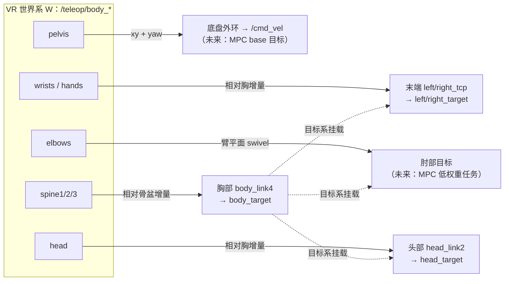

# 基于 VR 全身骨骼的轮式人形全身遥操作映射算法（设计稿）

> 状态：**v3 已实现——人体根参考系映射**。全身遥操作模式（case 30）内：
> **右摇杆短按**（事件 4）开/关「全部跟踪」→ 胸（§3.3）/ 头（§3.4）/ **双臂末端（§3.1）** 目标直接取
> 「人体部位相对**人体根 H**（骨盆地面投影 + 骨盆偏航）的位姿」，再作为机器人对应部位
> **相对底座**的目标发布（无按下时快照、无相对增量），因此人体走动/整体转身不会拖动手臂；
> **左摇杆按键**（事件 7，普通模式下为镜像切换）开/关「底盘跟踪」（§3.5 外环，已实现）。
> 肘部（§3.2）与 MPC base 目标（§3.5 接入草案、§6.3）仍为设计稿。
> 输入：XRoboToolkit 后端全身追踪（24 关节 SMPL 风格骨架，机器人轴约定）。
> 目标机器人示例：FiveAges W2（轮式人形；4 腰关节 + 7×2 臂 + 2 头关节；`body_link4` 胸部、`head_link2` 头部、`left/right_tcp` 末端）。

## 0. 目标与现状

| 跟踪对象 | 机器人参考 frame | 现状 | 本文档 |
|---|---|---|---|
| 双臂末端 | `left_tcp` / `right_tcp` | ✅ **人体根映射**（`body_left/right_hand_pose`） | §3.1 |
| 双臂肘部 | `{side}_link4`（joint4 轴心） | ❌ 未实现，未接 MPC | §3.2 |
| 胸部 | `body_link4` | ✅ **人体根映射**（`body_spine3_pose`，roll 投影丢弃） | §3.3 |
| 头部 | `head_link2` | ✅ **人体根映射**（`body_head_pose`，仅 yaw/pitch） | §3.4 |
| 底盘 | `base_footprint` (x, y, yaw) | ✅ **位置外环 → `/cmd_vel`**（左摇杆按键开关）；未接 MPC 目标 | §3.5 |

VR 侧数据（`xr_target_node`，XRoboToolkit 后端）：

- `/teleop/body_<关节名>_pose`（`geometry_msgs/Pose`，24 关节，头显开启 Whole Body Motion Tracking 且配对足部追踪器后动态出现，断流 5 s 销毁话题）；
- `/teleop/human_footprint_pose`（`geometry_msgs/Pose`，人体基坐标系：骨盆地面投影 xy + 双足较低者 z + 双踝 x 轴平均 yaw，由 `vr_pose_publisher` 计算，同样动态增删）；
- 与 `/teleop/head_pose`、手柄 pose **同一世界系、同一原点**（App 启动时头显位置），OpenXR→机器人轴转换已在上游 wrapper 完成。

## 1. 坐标系与数据语义

### 1.1 人体骨架拓扑（父→子）

```
pelvis(0) ─┬─ left_hip(1)  → left_knee(4)  → left_ankle(7)  → left_foot(10)
           ├─ right_hip(2) → right_knee(5) → right_ankle(8) → right_foot(11)
           └─ spine1(3) → spine2(6) → spine3(9) ─┬─ neck(12) → head(15)
                                                 ├─ left_collar(13)  → left_shoulder(16)  → left_elbow(18)  → left_wrist(20)  → left_hand(22)
                                                 └─ right_collar(14) → right_shoulder(17) → right_elbow(19) → right_wrist(21) → right_hand(23)
```

### 1.2 机器人被控 frame（W2 实测值）

| 对象 | frame | 说明 |
|---|---|---|
| 控制系 C | `base_footprint` | 目标统一在 C 中表达（现有 `control_base_frame`） |
| 胸部 | `body_link4` | 原点在腰顶上方 **0.1433 m**（躯干下沿）；`arm_base` 在其上 0.4576 m、`head_mount` 0.4848 m |
| 腰部 | `body_joint1/2/3` 绕 ±y（pitch）、`body_joint4` 绕 −z（yaw） | **无 roll 自由度** |
| 头部 | `head_link2` | `head_joint1` yaw(z)、`head_joint2` pitch(y)，关节间距 0.15 m |
| 末端 | `left_tcp` / `right_tcp` | 7-DOF 臂，肘在 `{side}_joint4`（link4 原点） |
| 底部 | `base_footprint` (x,y,yaw) | 轮式底盘，world→base TF 由外部提供 |

手臂标称几何（URDF 常量，落地时建议运行期从 FK 实测）：

- 上臂 $l_1 \approx 0.305$ m（joint2/3 轴心 → joint4 轴心）；
- 前臂 $l_2 \approx 0.314$ m（joint4 轴心 → joint5 轴心，再加 tcp 偏置到 tip）。

### 1.3 控制系与校准

- 记 VR 世界系为 W，控制系为 C。**人体根 $H$**（骨盆地面投影 + 骨盆偏航）是所有人体的量的参考系：
  人体相对自己的位姿 $T_{joint|H}$ 直接映射为机器人对应部位相对**底座**的目标，再乘 $T_{base\to world}$ 发布。
- 底座位姿 $T_{base\to world}$ 优先取 TF（`vr_follow_frame → ee_frame_id`，移动底盘下即 `base_footprint → world`）；
  无 TF 时回退到「对自己下发 `/cmd_vel` 的积分」。
- 非全身模式的相对增量路径仍沿用 `vr_follow_frame` + 冻结旋转机制（见下），本文档仅用统一记号表述。
- 若胸部开始跟踪（§3.3），建议将冻结旋转升级为逐帧更新：

$$
R_{C\leftarrow W}(t) = R^{r}_{body4}(t)\,R_{C\leftarrow W}(t_0)\,R^{h}_{spine3}(t_0)\,\big(R^{h}_{spine3}(t)\big)^{\top}
$$

（简化实现可继续用冻结值；误差表现为人体转身时手/肘方向滞后。）

### 1.4 数据质量约定

- PICO 全身追踪的脊柱/背后关节多为推断值：**几何一致性过滤**——$|p_{elbow}-p_{shoulder}|$、$|p_{wrist}-p_{elbow}|$ 偏离标称 ±20% 的帧丢弃（沿用上一帧）。
- 骨架帧率通常低于手柄；所有任务按"骨架帧"原子更新（同一帧驱动全部目标），不使用跨帧混合的关节。
- 单关节失效（话题销毁/帧内缺失）→ 只冻结对应任务，其余正常。

## 2. 总体框架

三条原则：

1. **相对增量**：一切任务 = "接管时刻基准 + 增量"，不做人体→机器人绝对对齐，天然兼容体型差异与穿戴变化。
2. **任务链（挂胸）**：末端/肘/头在**胸目标系**中表达，胸相对骨盆表达，底盘消费骨盆。胸转时手臂与头自动跟随，避免重复计数。
3. **独立门控/限幅/降级**：每组任务独立参数、独立失效处理。



## 3. 任务算法

### 3.0 记号

- $T^h_j(t)$：人体关节 $j$ 的 4×4 位姿（W 系）；$T^r_X(t)$：机器人 frame $X$ 的位姿；$p(\cdot)$、$R(\cdot)$ 取平移/旋转。
- $\Delta T^{h} = T(t)\,T(t_0)^{-1}$：**左乘增量**（在同一父系中表达的变化）。
- $\mathrm{Exp}/\mathrm{Log}$：SO(3) 指数/对数映射；$\mathrm{slerp}$、$\mathrm{norm}$、$\mathrm{clamp}$。
- $t_0$：接管时刻（进入 UPDATE / 单臂 rebase / 任务重新使能）。

### 3.1 双臂末端（EE）

> **已实现（绝对映射）**：全身遥操作模式内按右摇杆（事件 4）开启「全部跟踪」后，双臂末端不再用
> 冻结基准 + 增量，而是逐帧按：
>
> $$p^{r}_{E|base}(t) = R_{\mathrm{align}}\,p^{h}_{hand|H}(t),
>   \qquad R^{r}_{E|base}(t) = R_{\mathrm{align}}\,R^{h}_{hand|H}(t)\,C_{hand\to E}$$
>
> 其中 **人体根 H 由 `vr_pose_publisher` 的 `HumanFootprintEstimator` 统一计算**
> （话题 `/teleop/human_footprint_pose`）：位置 xy = **骨盆**在地面的投影、z = 两**足**较低者；
> 朝向 = 两**踝** x 轴在地平面投影的平均；俯仰/滚转恒为 0（即 H 永远是竖直系）；
> 位置 xy/z 一阶低通，最后加一个人体基坐标系自身系下的三轴原点偏置
> （`human_footprint_filter_alpha` / `human_footprint_offset`，或环境变量
> `XR_HUMAN_FOOTPRINT_FILTER_ALPHA` / `XR_HUMAN_FOOTPRINT_OFFSET`）。
> （VR 世界系原点是头显启动时的头部，z=0 不是地面。）
>
> **骨架分段尺度**（只缩放「段向量」，因此关节姿态完全不变、人体根与地面不动）：
>
> $$
> \begin{aligned}
> p'_{spine3}   &= p_{pelvis} + s_{body}\,(p_{spine3}-p_{pelvis})\\
> p'_{head}     &= p'_{spine3} + s_{body}\,(p_{head}-p_{spine3})\\
> p'_{shoulder} &= p'_{spine3} + s_{shoulder}\,(p_{shoulder}-p_{spine3})\\
> p'_{hand}     &= p'_{shoulder} + s_{arm}\,(p_{hand}-p_{shoulder})
> \end{aligned}
> $$
>
> $s_{body}$ = `body_length_scale`、$s_{shoulder}$ = `shoulder_width_scale`、
> $s_{arm}$ = `arm_length_scale`；>1 表示机器人对应尺寸比人体大。
> 段向量必须用**原始**端点作差、再累加到**变形后**的父节点上。
> $p^{h}_{hand|H}$ 取其上式的 $p'_{hand}$，其 z 即「离地高度」。
> 目标先表达为「机器人末端相对**底座**」的目标，再乘底座位姿发到 world。关键语义：
> - **人体自身的行走/整体转身被 $H$ 完全吸收**，只去驱动底盘速度指令——
>   底盘锁定时人走动或整体转身都不会拖动手臂目标；
> - **没有「按下时快照 + 相对增量」**：机器人头摆正、人体头侧向 30° 时，
>   开启跟踪后目标立即就是 30°；
> - $R_{\mathrm{align}} = R_z(\texttt{absolute\_map\_yaw\_deg})$；$C_{hand\to E}$ 是固定旋转偏置
>   （`hand_to_ee_rpy_deg_left/right`，默认 `[-90,0,0]`/`[90,0,0]`）。
>
> 数据源默认 `body_left/right_hand_pose`。优点：人体胸转时手自然跟随，不需要下面的相对胸系补偿。
> **下面的相对增量描述仅适用于非全身模式**（手柄驱动双臂 / 头显驱动 WBC 头部目标）；
> 全身遥操作模式内的相对模式已删除。

接管时记录：机器人手臂相对胸的位姿 $T^{r}_{E|C}(t_0) = T^{r}_{C}(t_0)^{-1} T^{r}_{E}(t_0)$；
人体手腕相对人体胸的位姿 $T^{h}_{wrist|spine3}(t_0)$。

每帧（相对胸增量）：

$$
\Delta T^{h}(t) = T^{h}_{wrist|spine3}(t)\,\big(T^{h}_{wrist|spine3}(t_0)\big)^{-1}
$$

$$
\boxed{\;T^{r}_{E}(t) = T^{r}_{C}(t)\;\Delta T^{h}(t)\;T^{r}_{E|C}(t_0)\;}
$$

- 平移增益 $s_{arm}$（默认 1.0）；旋转可选分轴增益/限幅（默认 1.0）。
- **数据源**（可配置优先级）：手柄 pose（现状，最稳）→ `wrist`(20/21) → `hand`(22/23)。
- **锚定选项** `ee_anchor`：
  - `chest`（默认，本算法）：胸转 → 手随胸转；
  - `world`（现状兼容）：胸转 → 手保持世界位置（目标中补偿胸转动）。
- 与现状差异：现有实现把增量叠在世界系绝对锚点上；本算法把锚点挂到胸目标，是"全身"语义的修正。

### 3.2 双臂肘部（新增，未接 MPC）

人体只能提供**方向信息**（人体臂长 ≠ 机器人臂长），因此用"臂平面"而非绝对位置：

1. 人体肘部偏离肩–腕连线的方向（W 系，单位向量）：

$$
a_h = \mathrm{norm}\big(p^h_{wrist} - p^h_{shoulder}\big)
$$

$$
s_h = \mathrm{norm}\Big(\big(p^h_{elbow} - p^h_{shoulder}\big) - \big((p^h_{elbow}-p^h_{shoulder})\cdot a_h\big)a_h\Big)
$$

2. 映射到控制系：$s_C = R_{C\leftarrow W}(t)\, s_h$。

3. 机器人几何（FK/URDF）：肩点 $p_S$、上臂长 $l_1$、前臂长 $l_2$、当前 EE 目标 $p_E = p^{r}_{E}(t)$：

$$
a = \mathrm{norm}(p_E - p_S),\qquad
d = \mathrm{clamp}\big(\|p_E - p_S\|,\; |l_1 - l_2| + \epsilon,\; l_1 + l_2 - \epsilon\big)
$$

$$
\theta = \arccos\!\left(\frac{l_1^2 + d^2 - l_2^2}{2\,l_1 d}\right)
\qquad (\text{余弦定理，肩–肘方向与肩–EE 方向夹角})
$$

4. 肘方向 = 肩–腕轴 + 人体肘侧方向：

$$
g = s_C - (s_C \cdot a)\,a,\qquad \hat g = g / \|g\|
$$

$$
\boxed{\;p^{ref}_{EL} = p_S + l_1\big(\cos\theta\,a + \sin\theta\,\hat g\big)\;}
$$

**退化与连续化处理**：

| 情况 | 处理 |
|---|---|
| $\|g\|\ < \epsilon_g$（人体伸臂，方向退化） | 保持上一帧 $\hat g$ |
| $d$ 超出手臂可达（EE 目标不可达） | clamp 到边界；肘目标随边界冻结 |
| $\hat g$ 与前帧反向（跨奇异翻转） | 与前帧点积为负时取反，再做一阶低通 |
| 肘关节缺失/不合格帧 | 冻结肘目标 |

**MPC 接入草案**（当前未实现）：

- 建议作为**低权重位置任务**：$\min \|p_{EL}(q) - p^{ref}_{EL}\|^2_{W_{el}}$，$W_{el} = w_{el} I$，$w_{el} \approx 0.05\text{–}0.2 \times w_{EE}$。
- 7-DOF 臂 − 6-DOF EE = 1 维冗余，该任务恰好占据冗余自由度；权重失衡时只会被 EE 任务部分覆盖，不会导致无解，因此实现上最稳。
- 接口草案：`left_elbow_target` / `right_elbow_target`（`geometry_msgs/PointStamped`，`frame_id = C`）。
- 落地顺序：先 TF/marker 可视化验证 swivel 稳定性 → 再入 MPC。

### 3.3 胸部（`body_link4`）

> **已实现（人体根映射）**：
> - 位置（底座系）$p^{B}_{body}=s R_a\left[p_{sp3|H}+\lambda\left(p_{pelv|H}-p_{sp3|H}\right)\right]$，
>   即沿「spine3 → pelvis」脊柱轴退到解剖对应点；`body_anchor_lambda` 默认 1（取骨盆位置）；
> - 姿态 = `R_align·R_spine3|H·body_src_to_ee_rpy_deg` 后**按 ZYX 分解丢弃 roll**（W2 腰无 roll）；
> - 一阶低通 + `skeleton_timeout` 看门狗冻结。
>   以下"相对骨盆增量"描述**仅适用于非全身模式**（手柄驱动的腰部 marker）；
>   全身遥操作模式内的相对模式（`captureWholeBodyTeleopBases`）已删除。

**姿态**（相对骨盆，避免与底盘 yaw 双重计数）：

$$
R^{h}_{t|p}(t) = \big(R^h_{pelvis}(t)\big)^{\top} R^h_{spine3}(t)
\qquad
\Delta R = R^{h}_{t|p}(t)\,\big(R^{h}_{t|p}(t_0)\big)^{\top}
$$

- **α 缩放**（人体胸部偏上的修正）：人体躯干曲率分布在 3 段脊柱上，机器胸 `body_link4` 枢轴偏下、且无 roll。先对增量做对数缩放：

$$
\Delta R_\alpha = \mathrm{Exp}\big(\alpha\,\mathrm{Log}(\Delta R)\big),\qquad \alpha \approx 0.6\text{–}0.8
$$

- **分轴增益 + 限幅**（利用 W2 腰部 3 pitch + 1 yaw、无 roll 的实际自由度）：把 $\mathrm{Log}(\Delta R_\alpha)$ 分解到 C 系三轴，逐轴乘增益并限幅，roll 分量丢弃或并入 pitch：

$$
\Delta R_w = \mathrm{Exp}\Big(\sum_{k\in\{x,y,z\}} \mathrm{clamp}\big(g_k\,\theta_k,\; -\theta^{max}_k,\; \theta^{max}_k\big)\,\hat e_k\Big)
$$

$$
\boxed{\;R^{r}_{C}(t) = \Delta R_w\,R^{r}_{C}(t_0)\;}
$$

**位置**（弱映射，可选）：

$$
\Delta p = \mathrm{diag}(s_x, s_y, s_z)\Big[\big(p^h_{spine3}(t)-p^h_{pelvis}(t)\big)-\big(p^h_{spine3}(t_0)-p^h_{pelvis}(t_0)\big)\Big]
$$

$$
p^{r}_{C}(t) = p^{r}_{C}(t_0) + R_{C\leftarrow W}(t_0)\,\Delta p
$$

默认 $s_x = s_y = 0$、$s_z \approx 0.5$（弯腰/起身的躯干高度变化），z 限幅 ±4 cm。

门控：WBC `bodyTrackingEE` capability + `body_target_enabled` + `BODY_TRACKING` 模式（沿用现有 `body_target` 通道）。

### 3.4 头部（`head_link2`）

> **已实现（人体根映射）**：目标位置（底座系）= `scale·R_align·p_body_head|H`，
> 目标姿态 = `R_align·R_body_head|H·head_src_to_ee_rpy_deg` 后仅保留 yaw/pitch（roll 丢弃）。
> 以下"相对胸增量"描述**仅适用于非全身模式**（头显驱动 WBC 头部目标）；
> 全身遥操作模式内的相对模式已删除。

**相对胸**（关键修正：现在锚在 base/world，胸动时头目标不会同步，会在胸转时产生反补）：

$$
T^{h}_{H|ch}(t) = \big(T^{h}_{spine3}(t)\big)^{\top} T^{h}_{head}(t)
$$

$$
\Delta T = T^{h}_{H|ch}(t)\,\big(T^{h}_{H|ch}(t_0)\big)^{\top}
$$

接管时机器人头相对胸：$T^{r}_{H|C}(t_0) = T^{r}_{C}(t_0)^{-1}\,T^{r}_{H}(t_0)$（FK/TF）。

$$
\boxed{\;T^{r}_{H}(t) = T^{r}_{C}(t)\;\Delta T_w\;T^{r}_{H|C}(t_0)\;}
$$

- $\Delta T_w$：平移增益 $s_{head}$（默认 1.0，保持现有 1:1 手感）；旋转仅保留机器人头 2 关节可达分量（yaw/pitch），分轴限幅（超出部分丢弃）。
- 门控沿用现状：FULL_BODY + UPDATE + FSM=OCS2 + `head_state=HEAD_TRACKING`。

### 3.5 底盘（v1 已实现：位置外环 → `/cmd_vel`）

> **已实现**：全身遥操作模式内**左摇杆按键**（上游事件 7，普通模式下为镜像切换）开/关「底盘跟踪」，独立于「全部跟踪」。
> 实现要点（与下面公式的差异已标注）：
> - 坐标系：接管时刻冻结 `R_{F←VR} = R_z(-ψ_pelvis(t_0))`（F = 接管时刻机器人本体系），
>   机器人自身转向用**积分自己下发的 ω** 补偿（不依赖外部 TF）；
> - 偏航：**绝对跟踪** `e_ψ = wrap(Δψ_human − ψ_offset)`、`ω = clamp(kψ·e_ψ, wmax)`，
>   不使用软参考（因此 `base_follow_tau_yaw` 目前为预留参数）；
> - 平移：软参考「跑步机」（下面公式），稳态速度增益 ≈ `base_follow_kp · base_follow_tau`；
> - 输出全向 `linear.x / linear.y / angular.z`，共享现有 VR 让路规则：
>   **仅 `BASE_LOCKED` 下发**，`BASE_UNLOCKED` 时冻结跟随并把软参考与人体同步（不报错）；
> - 普通模式的手动底盘遥控（case 20）在全身模式下不可用；进入全身模式时 CHASSIS 会被强制退出并零速。

人体 footprint（`/teleop/human_footprint_pose`：骨盆地面投影 + 双踝 yaw + 双足地面 z）提供水平位置 $p^h_p$ 与偏航 $\psi_h = \mathrm{yaw}(R^h_{H})$。采用**位置外环 → 速度**方案（不需要 MPC 改动即可闭环）：

**软参考（"跑步机"机制，防止用户走出追踪区）**：

$$
\dot p_{ref} = (p^h_p - p_{ref})/\tau,\qquad
\dot\psi_{ref} = \mathrm{wrap}(\psi_h - \psi_{ref})/\tau_\psi
\qquad (\tau \approx 2.0\,\mathrm{s})
$$

**误差与速度**：

$$
e = p^h_p - p_{ref},\qquad e_\psi = \mathrm{wrap}(\psi_h - \psi_{ref})
$$

$$
v^{W} = \begin{cases} \mathrm{clamp}(K_p\,e,\; v_{max}), & \|e\| > \delta \\ 0, & \text{否则} \end{cases}
\qquad
\omega = \mathrm{clamp}(K_\psi\,e_\psi,\; \omega_{max})
$$

$$
v^{B} = R_z(\psi_{base})^{\top} v^{W}
$$

- 输出 `/cmd_vel`：差速底盘 `linear.x = v^B_x`、`angular.z = ω`；全向底盘加 `linear.y = v^B_y`。
- 一阶低通（τ ≈ 0.2 s）+ 速率限幅 + 零速退出（失能瞬间发一次 0，沿用现有清零逻辑）。
- **使能策略**（需确认）：建议显式使能（组合键/状态），仅 `FSM=OCS2` 下可用；`BASE_UNLOCKED` 时与 WBC 底盘控制权冲突，需要与 WBC 的 `/cmd_vel` 让路规则统一（短期：仅在 `BASE_LOCKED` 下允许跟随；长期：接入 MPC base 目标）。
- 已知限制：骨盆在行走中的上下起伏与左右摆动不进映射（低通/只取水平分量）；站立转身时臀部后摆会被误读为位移——τ、死区、增益需要在真机上调。

**MPC 接入草案**（当前未实现）：

- wheel-humanoid 的 state 前 3 维已是 base `[x, y, yaw]`；需要把 teleop 目标作为 **base 段参考轨迹**加入（`WheelHumanoidTargetNode` / `PoseBasedReferenceManager` 的布局扩展），并在 cost 中加 base tracking 权重。
- 接口草案：`base_target`（`geometry_msgs/PoseStamped`，frame = world/odom），或直接由 reference manager 消费外环输出。
- 接入后可去掉 τ 软参考或保留为"期望轨迹生成器"。

## 4. 任务依赖与优先级

| 层 | 任务 | 依赖的父系 | MPC 权重建议 |
|---|---|---|---|
| 1 | 底盘 (x, y, yaw) ← 骨盆 | 世界 | 平衡/约束优先，追踪权重低 |
| 2 | 胸姿态 ← 脊柱相对骨盆 | 骨盆（=底盘） | 中 |
| 3 | 头 ← 相对胸 | 胸目标 | 中 |
| 3 | 末端 6D ← 相对胸 | 胸目标 | 高 |
| 4 | 肘 3D ← 臂平面 | 末端目标 | 低（冗余任务） |

规则：

- 骨盆 **yaw 只给底盘**；胸只消费"脊柱相对骨盆"，避免同一旋转被吃两次。
- 底盘锁定（`BASE_LOCKED`）时可选参数：把骨盆 yaw 转给腰 yaw（`body_joint4`）。
- 胸转时末端/肘/头自动继承（3.1/3.4 的挂载语义）；不再需要"胸转手补"的特殊处理。

## 5. 状态机、门控与安全

沿用**普通模式**现有语义：STORAGE/UPDATE、右摇杆接管、单臂禁用/rebase、镜像、暂停、事件 16 语义锁存。
**全身遥操作模式内**：右摇杆短按（事件 4）= 「全部跟踪」开关、
左摇杆按键（事件 7）= 「底盘跟踪」开关；其余普通模式组合键全部不可用（只共享 FSM 与夹爪）。

**模式的自动退出（与普通遥操作一致）**：全身遥操作是「OCS2 会话级」开关，权威 FSM
（`ArmsTargetManager`）一离开 OCS2（HOLD / HOME / MOVEJ，含控制器侧异常自动回 HOLD）就退出
整个模式，「全部跟踪」与「底盘跟踪」一并关闭（WBC 保持当前目标），回到 OCS2 后需重新按
组合键开启；控制拓扑不再是 FULL_BODY 时同理。判定同时放在 FSM 命令回调、按键/摇杆入口与
50 Hz 底盘外环里，因此非 FSM 命令来源的切换也能触发。

逐任务门控与失效行为（已实现）：

| 任务 | 门控 | 数据失效行为 |
|---|---|---|
| 末端 | 全身模式 + 全部跟踪 + FSM=OCS2 + 该臂未被 WBC 禁用 | 冻结（该臂），不回退禁用前目标 |
| 肘 | 末端任务有效 + 肘关节几何合格 | 冻结（**本版未实现**） |
| 胸 | WBC `bodyTrackingEE` + `BODY_TRACKING` + 全部跟踪 | 冻结（不发 `body_target`） |
| 头 | `HEAD_TRACKING` + 全部跟踪 | 冻结 |
| 底盘 | 底盘跟踪开 + FSM=OCS2 + 人体 footprint 数据未超时；`BASE_UNLOCKED` 让路 | 发一次 0 后停止 |

所有上肢任务共用「人体根 H」前置条件：`has_body_pelvis_pose_` 且骨盆数据未超时；
H 无效（看门狗超时）时上肢目标一并冻结。

限幅汇总：

| 量 | 建议限幅 |
|---|---|
| EE 目标 | 球面裁剪到臂可达半径（$l_1 + l_2$ 内收缩 ε） |
| 肘目标 | 随 EE 目标 clamp；$\hat g$ 低通 |
| 胸部姿态 | α 缩放 + 分轴限幅（pitch/yaw 各自 ≤ 可复现范围，roll 丢弃） |
| 胸部位置 | z 限幅 ±4 cm，x/y 默认 0 |
| 头部 | yaw/pitch 限幅，超限丢弃 |
| 底盘 | $v_{max}$ ≈ 0.3–0.5 m/s，$\omega_{max}$ ≈ 0.5–1.0 rad/s，速率限幅 |

## 6. 接口与集成

### 6.1 现有话题（不改）

`left/right_target`、`body_target`、`head_target`、`left/right_target/twist` 等，以及 `left/right/body/head_current_target` 反馈。

### 6.2 新增话题草案

| 话题 | 类型 | 状态 |
|---|---|---|
| `left_elbow_target` / `right_elbow_target` | `geometry_msgs/PointStamped`（frame = C） | 未实现（MPC 未消费） |
| `base_target` | `geometry_msgs/PoseStamped`（world/odom，x/y/yaw） | 未实现（MPC 未消费）；**当前用 `/cmd_vel` 位置外环替代**（§3.5） |
| `/teleop/body_skeleton`（VR 侧聚合话题，可选） | 自定义 msg 或 `PoseArray` + 关节名数组 + 时间戳 | 建议：C++ 消费者订阅 24 个动态话题较笨重，聚合后便于原子帧处理 |

### 6.3 MPC 参考向量扩展草案

- wheel-humanoid 目标布局新增：elbow 段（2×3 或 6 维，低权重）、base 目标段（若参考中尚无 teleop 来源的 base 目标）。
- capability 门控：`WbcCapability` 增加 `elbow_tracking_enabled`、`base_tracking_enabled`，与 `bodyTrackingEE` / `headTrackingEE` 同套路。

## 7. 参数表（建议命名）

| 参数 | 默认 | 说明 |
|---|---|---|
| `ee_anchor` | `chest` | `chest` / `world`（兼容现状） |
| `ee_source` | `controller` | `controller` / `wrist` / `hand` |
| `ee_translation_gain` | 1.0 | 末端平移增益 |
| `elbow_enable` | false | 肘任务开关（MPC 未接入前仅可视化） |
| `elbow_pos_filter_alpha` | 0.9 | $\hat g$ 低通 |
| `chest_alpha` | 0.7 | 躯干旋转对数缩放 |
| `chest_pitch_gain` / `chest_yaw_gain` | 1.0 / 0.8 | 分轴增益 |
| `chest_pitch_max` / `chest_yaw_max` | 25° / 30° | 分轴限幅 |
| `chest_z_gain` | 0.5 | 胸位置 z 映射（x/y 默认 0） |
| `head_translation_gain` | 1.0 | 头平移 |
| `head_yaw_max` / `head_pitch_max` | URDF 限位内 | 头部分轴限幅 |
| `skeleton_timeout` | 0.2 s | 骨架数据超时（逐任务冻结） |
| ~~`human_root_filter_alpha`~~ / ~~`human_root_offset`~~ | — | **已迁移**到 `vr_pose_publisher`：`XR_HUMAN_FOOTPRINT_FILTER_ALPHA` / `XR_HUMAN_FOOTPRINT_OFFSET` |
| `body_anchor_lambda` | 1.0 | 胸部位置沿脊柱轴的锚点比例（0=spine3，1=骨盆）；姿态仍由 spine3 定 |
| `skeleton_geometry_tolerance` | 0.2 | 臂长一致性容差（20%，手–脊柱距离） |
| `absolute_ramp_enable` | true | 接管渐入总开关 |
| `absolute_ramp_max_linear_velocity` / `_max_angular_velocity` | 0.15 / 0.4 | 过渡段速度上限 (m/s / rad/s) |
| `absolute_ramp_min_duration` / `_max_duration` | 0.2 / 3.0 | 过渡时长钳位 (s) |
| `absolute_ramp_resume_gap` | 0.3 | 输出中断超过该时长后重新渐入 (s) |

### 7.1 已实现参数（默认值见 `config/default.yaml`）

| 参数 | 默认 | 说明 |
|---|---|---|
| `body_ee_source` | `hand` | 双臂末端数据源：`hand` / `wrist` |
| `body_length_scale` / `shoulder_width_scale` / `arm_length_scale` | 1.0 / 1.0 / 1.0 | 骨架分段尺度（只缩放段向量，姿态不变） |
| ~~`absolute_map_yaw_deg`~~ | — | 已删除（「人体系」锚定，人体朝向 ≡ 机头朝向） |
| `hand_to_ee_rpy_deg_left` / `_right` | [-90,0,0] / [90,0,0] | 手部坐标系 → 末端坐标系固定旋转偏置（度） |
| `body_src_to_ee_rpy_deg` / `head_src_to_ee_rpy_deg` | [0,0,0] | 胸部/头部源→目标固定旋转偏置（度） |
| `absolute_filter_alpha` | 0.3 | 绝对目标一阶低通系数 |
| `capture_settle_ms` | 200 | 标定前稳定窗口 (ms) |
| `base_follow_enable` | true | 底盘跟踪总开关（左摇杆按键） |
| `base_follow_rate` | 50.0 | 外环频率 (Hz) |
| `base_follow_tau` | 2.0 | 软参考时间常数 (s) |
| `base_follow_kp` | 0.5 | 位置增益（稳态增益 ≈ kp·tau = 1.0） |
| `base_follow_kpsi` | 1.0 | 偏航增益（绝对跟踪） |
| `base_follow_deadband` / `base_follow_yaw_deadband` | 0.02 / 0.05 | 死区 (m / rad) |
| `base_vmax` / `base_wmax` | 0.4 / 0.8 | 速度限幅 (m/s / rad/s) |
| `base_acc_max` / `base_alpha_max` | 1.0 / 2.0 | 加速度限幅 (m/s² / rad/s²) |
| `base_cmd_tau` | 0.2 | 指令低通 (s) |
| `base_follow_data_timeout` | 0.2 | 人体 footprint 数据看门狗 (s) |
| `base_follow_tau_yaw` | 2.0 | **预留**（偏航为绝对跟踪，不使用软参考） |
| `absolute_ramp_enable` | true | 接管渐入总开关（关掉即旧行为） |
| `absolute_ramp_max_linear_velocity` | 0.15 | 过渡段线速度上限 (m/s) |
| `absolute_ramp_max_angular_velocity` | 0.4 | 过渡段角速度上限 (rad/s) |
| `absolute_ramp_min_duration` / `absolute_ramp_max_duration` | 0.2 / 3.0 | 过渡时长钳位 (s) |
| `absolute_ramp_resume_gap` | 0.3 | 输出中断超过该时长后重新渐入 (s) |

上游 `xr_target_node`：右摇杆只有松开沿短按事件 `4`（长按与事件 `31` 已删除）。
全身模式下事件 `7` 由下游重解释为底盘跟踪；普通模式下仍为镜像切换。

## 8. 仿真验证清单

单项：

1. 手抬 0.1 m → EE 目标变化 0.1 m；手不动、胸转 30° → EE 随胸转（绝对映射下自动成立）。
2. 屈肘 90° → 肘目标绕肩–腕轴到侧向；伸臂 → 肘目标冻结不跳变。
3. 弯腰 30° → 胸 pitch 变化 ≈ α·30°，无 roll 输出；转身 60° → 胸 yaw 变化并限幅。
4. 转头 30° → 头目标相对胸变化，胸不动；胸转时头保持相对胸不变。
5. 原地走 2 步 → 底盘跟随位移 ≈ 人体位移，软参考在 τ 内回中；站立不动 → 无速度输出。

组合与边界：

6. 走过去拿东西：底盘移动 + 手跟踪 + 头部注视同时进行，无目标跳变。
7. 骨架断流 → 全部冻结；仅肘关节缺失 → EE/胸/头正常。
8. EE 目标不可达 → 肘 clamp、无奇异跳变；镜像模式下左右映射正确。
9. 底盘使能/失能瞬间 → 零速一次、无残留运动。

## 9. 待确认问题

已定：

1. ~~骨架频率/延迟是否足以驱动末端~~ → **已定**：双臂末端改为骨架绝对映射（`body_*_hand_pose`），
   手柄仅保留非全身模式的相对增量路径与 `enable()` / 尺度校准触发。
2. ~~底盘跟随的使能方式与 `BASE_UNLOCKED` 冲突策略~~ → **已定**：全身模式内**左摇杆按键**开关；
   `BASE_UNLOCKED` 时冻结跟随、软参考与人体同步、让路给 WBC。
3. ~~胸部是否需要位置映射~~ → **已定**：位置取沿脊柱轴的锚点（λ=1 即骨盆位置），roll 丢弃。
4. 肘任务 MPC 权重、以及是否先做可视化验证（**仍未实现**）。
5. PICO 骨架是否提供逐关节有效位/速度（当前用「手–脊柱距离几何一致性 + 超时看门狗」替代）。

新待确认：

6. 绝对映射的手感需要真机标定：`body_length_scale` / `shoulder_width_scale` / `arm_length_scale`、
   `hand_to_ee_rpy_deg_left/right`、`absolute_filter_alpha` 的默认值是否合适。
   `*_to_ee_rpy_deg` 修正「数据源坐标系 → 目标坐标系」的轴向差异
   （换 `body_ee_source=wrist` 或换机型必须重调）；
   偏航不需要参数：映射按「人体系」锚定，人体朝向即机头朝向。
7. ~~**接管瞬间姿态会跳变**~~ → **已实现接管渐入**：开启「全部跟踪」后，胸/头/双臂目标从
   当前保持位姿按 `absolute_ramp_max_*_velocity` 限速过渡到实时 VR 期望位姿，
   过渡时长 `T = 1.875·max(|Δp|/v, Δθ/ω)` 钳到 `[absolute_ramp_min_duration, _max_duration]`，
   进度用五次多项式（两端速度/加速度为 0），收敛后恢复直通；骨架超时冻结恢复时
   （输出中断 > `absolute_ramp_resume_gap`）也会重新渐入。
8. **无 TF 时底座位姿靠 `/cmd_vel` 积分**：打滑、限速饱和、或被导航/手柄驱动时会产生偏差。
   有条件时应在底盘侧发 `world→base_footprint` TF。
9. `ψ_offset`（底盘外环的 yaw 补偿）同样靠积分自下发 ω，漂移风险同上。
